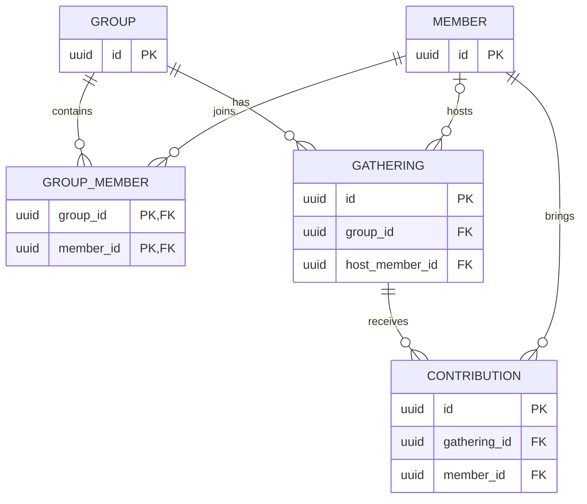

# HostCircle — Data & API Design

> **When:** Week 3 (Sections 0–2), Week 4 (Sections 3–4) · **Owner:** Architecture Lead / Data & API owner (to confirm)
>
> **Version:** 0.1 (draft)
>
> **Approved on:** Pending team review

This draft adapts the Product Owner-provided Data & API draft to the current proposed requirements in `docs/specification.md`. It is not approved. Update it after the Specification and ADR-00 are reviewed; unresolved product questions remain in the Specification.

## 0. Database & Storage

**Database:** PostgreSQL via Supabase, proposed pending confirmation in `docs/plan.md` ADR-00.

**Build option:** Simulated backend for the course build. The simulation must follow the entities, field names, endpoints, and response shapes below.

**We store:** Groups, group membership, gatherings, assigned hosts, and contributions with their responsible members.

**We do NOT store:** Passwords, payment information, contact lists, private messages, member rankings, contribution scores, or unrelated profile data.

**Sensitive fields:** `Member.display_name` is personal data. Use fictional names in the public prototype. A future real implementation must restrict group records to that group's authenticated members.

**Pending decisions:** Confirm the database in ADR-00; decide whether groups and members are fixed sample data; resolve host and contribution permissions; confirm whether a history-based rotation is required. See Specification Q1, Q5, and Q6.

## 1. Entities

Every field below traces to a proposed requirement in the Specification. The entities and fields remain provisional until the team approves those requirements.

### Entity: Group

| Field | Type | Key | Required? | Req ID |
|-------|------|-----|-----------|--------|
| `id` | uuid | PK | Yes | R1 |
| `name` | varchar(100) | | Yes | R1 |

**Delete rule:** Deleting a Group would delete its GroupMember and Gathering records; deleting a Gathering would delete its Contributions. This destructive behavior is proposed only and must not be implemented until the team decides whether deletion is in scope.

### Entity: Member

| Field | Type | Key | Required? | Req ID |
|-------|------|-----|-----------|--------|
| `id` | uuid | PK | Yes | R2, R3 |
| `display_name` | varchar(80) | | Yes | R2, R3 |

**Delete rule:** Block deletion while a Member is referenced by a GroupMember, Gathering host, or Contribution, to preserve group and gathering history.

### Entity: GroupMember

| Field | Type | Key | Required? | Req ID |
|-------|------|-----|-----------|--------|
| `group_id` | uuid | PK, FK → Group | Yes | R1, R2, R3 |
| `member_id` | uuid | PK, FK → Member | Yes | R1, R2, R3 |

The composite primary key prevents duplicate membership. Deleting a Group deletes its GroupMember records. Deleting a Member is blocked while referenced.

### Entity: Gathering

| Field | Type | Key | Required? | Req ID |
|-------|------|-----|-----------|--------|
| `id` | uuid | PK | Yes | R1 |
| `group_id` | uuid | FK → Group | Yes | R1 |
| `title` | varchar(120) | | Yes | R1 |
| `scheduled_at` | timestamptz | | Yes | R1 |
| `host_member_id` | uuid | FK → Member | No | R2 |

Deleting a Group deletes its Gatherings. Deleting a Member referenced as a host is blocked. `host_member_id` is optional so a gathering can be created before its host is assigned.

### Entity: Contribution

| Field | Type | Key | Required? | Req ID |
|-------|------|-----|-----------|--------|
| `id` | uuid | PK | Yes | R3 |
| `gathering_id` | uuid | FK → Gathering | Yes | R3 |
| `member_id` | uuid | FK → Member | Yes | R3 |
| `description` | varchar(200) | | Yes | R3 |

Deleting a Gathering deletes its Contributions. Deleting a Member referenced by a Contribution is blocked. `description` is a provisional item label; whether quantity or a more specific contribution type is needed is open in Specification Q3.

**Provisional validation rules:** A host and contribution member must be a member of the Gathering's Group. The team must confirm this rule and the permissions for assigning or recording for another member (Specification Q5).

## 2. Entity Relationship Diagram (ERD)



The ERD shows the proposed relationships. Same-group host and contributor validation is an application rule and is not expressed by these foreign keys alone.

## 3. Normalization Check

- [x] **1NF** — Each field holds one value; contributions are separate records rather than a list on Gathering.
- [x] **2NF** — Each non-key field depends on its entity's full primary key; GroupMember has no non-key fields.
- [x] **3NF** — Group, Member, Gathering, and Contribution details are stored on their own entities rather than duplicated on related entities.

**Intentional exceptions:** None in this draft.

## 4. API Endpoints

These are proposed endpoints for R1–R3. Permission details remain pending Specification Q5. No group/member setup endpoints are defined until Q6 is resolved. Login endpoints are not included because the Specification has no login requirement and ADR-00 has not been confirmed.

| Req ID | Method | Path | Request | Success response | Errors | Who can call it |
|--------|--------|------|---------|------------------|--------|-----------------|
| R1 | `POST` | `/v1/groups/{groupId}/gatherings` | `{ "title": string, "scheduledAt": ISO-8601 datetime }` | `201` with the created Gathering | `400`, `401`, `403`, `404` | Group member; permission policy pending Q5 |
| R1 | `GET` | `/v1/groups/{groupId}/gatherings` | None | `200` with an array of Gatherings | `401`, `403`, `404` | Group member; permission policy pending Q5 |
| R1 | `GET` | `/v1/gatherings/{gatheringId}` | None | `200` with the Gathering, including its host reference | `401`, `403`, `404` | Group member; permission policy pending Q5 |
| R2 | `PATCH` | `/v1/gatherings/{gatheringId}` | `{ "hostMemberId": uuid }` | `200` with the updated Gathering | `400`, `401`, `403`, `404` | Group member; permission policy pending Q5 |
| R3 | `POST` | `/v1/gatherings/{gatheringId}/contributions` | `{ "memberId": uuid, "description": string }` | `201` with the created Contribution | `400`, `401`, `403`, `404` | Group member; permission policy pending Q5 |
| R3 | `GET` | `/v1/gatherings/{gatheringId}/contributions` | None | `200` with an array of Contributions | `401`, `403`, `404` | Group member; permission policy pending Q5 |

### Proposed response shapes

#### Gathering

```json
{
  "id": "uuid",
  "groupId": "uuid",
  "title": "Game Night",
  "scheduledAt": "2026-12-05T19:00:00Z",
  "hostMemberId": "uuid-or-null"
}
```

#### Contribution

```json
{
  "id": "uuid",
  "gatheringId": "uuid",
  "memberId": "uuid",
  "description": "Ice",
  "memberDisplayName": "Sample Member"
}
```

`memberDisplayName` is derived from the related Member record and is not stored on Contribution. Responses and field names are provisional until the Specification and this document are approved.

## Requirement Traceability

| Requirement | Entities and fields | Endpoints | Status |
|-------------|---------------------|-----------|--------|
| R1 | Group, GroupMember, Gathering (`id`, `group_id`, `title`, `scheduled_at`) | `POST/GET /v1/groups/{groupId}/gatherings`, `GET /v1/gatherings/{gatheringId}` | Draft; group/member setup and deletion behavior unresolved. |
| R2 | Member, GroupMember, Gathering (`host_member_id`) | `PATCH /v1/gatherings/{gatheringId}` | Draft; eligibility and permissions unresolved. |
| R3 | Member, GroupMember, Contribution (`gathering_id`, `member_id`, `description`) | `POST/GET /v1/gatherings/{gatheringId}/contributions` | Draft; contribution definition and permissions unresolved. |

## SVC Self-Check

- [x] **Simple** — Proposed entities are nouns from the Spec and API paths use nouns.
- [ ] **Valuable** — Fields and endpoints trace to proposed requirement IDs; permissions and sensitive-data handling need team approval.
- [ ] **Complete** — Database must match ADR-00; open questions must be resolved; ERD must be rendered and reviewed; endpoint permissions and delete rules must be approved; team approval is pending.
